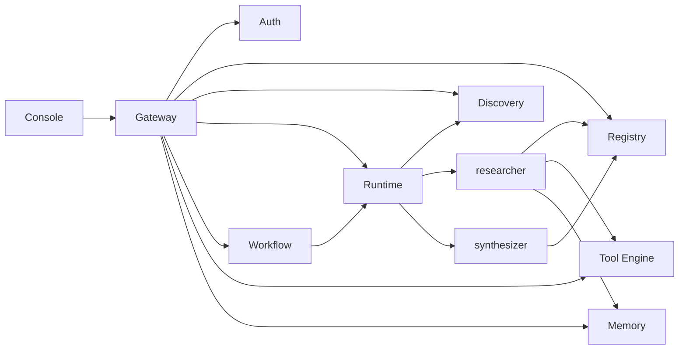

# AgentSphere

Enterprise **AI Agent Service Mesh** — control plane + data plane for agent identity, discovery, governed A2A invoke, tools, memory, and multi-agent workflows.

## Quick start (E2E)

```bash
cp .env.example .env
docker compose up --build
```

### Production deploy

Fail-closed gateway, strong secrets, internal ports bound to localhost:

```bash
export AS_JWT_SECRET="$(openssl rand -hex 32)"
export AS_BOOTSTRAP_SECRET="$(openssl rand -hex 32)"
docker compose -f docker-compose.yml -f docker-compose.prod.yml up --build -d
```

Local compose keeps `AS_GATEWAY_OPEN=true` for E2E. Production overlay sets it to `false` (JWT required). Console mints tokens via `/api/auth/token` so `AS_BOOTSTRAP_SECRET` never reaches the browser.

| Surface | URL |
| --- | --- |
| Gateway | http://localhost:8080 |
| Console | http://localhost:3000 |
| Mesh health | http://localhost:8080/mesh/health |
| OpenAPI (YAML) | http://localhost:8080/openapi.yaml |
| OpenAPI discovery | http://localhost:8080/openapi.json |

Client integrators should use the **Gateway OpenAPI** contract (`services/gateway/openapi/openapi.yaml`, also mirrored at `docs/openapi/agentsphere-gateway.openapi.yaml`). It documents auth, tenant isolation, error codes, rate limits, retries, and availability probes.

Smoke + demo:

```bash
pnpm smoke
pnpm demo
```

## Architecture



### Mesh layers

| Layer | Components |
| --- | --- |
| Edge | Gateway (`/mesh/*`) |
| Control plane | Auth, Registry, Discovery |
| Data plane | Runtime (A2A), Tool Engine, Memory, Notification |
| Orchestration | Workflow (`research-synthesize`) |
| Agents | SDK sidecars: register, heartbeat, `/v1/invoke` |

Full design: [AgentSphere_E2E_Blueprint.md](./AgentSphere_E2E_Blueprint.md)

## Monorepo

```
packages/contracts   Shared Zod contracts, ports, NATS subjects
packages/common      Logger, pg, http, health
packages/sdk         createAgent() mesh sidecar
services/*           Mesh microservices
agents/*             Sample researcher + synthesizer
apps/console         Operator UI
```

## Local package development

```bash
pnpm install
pnpm build
pnpm typecheck
```

### Multi-tenancy

AgentSphere is **multi-tenant by default**. Isolation boundary is `tenantId` (organization); optional `projectId` scopes within a tenant.

| Surface | Behavior |
| --- | --- |
| JWT | `sub`, `role`, `tenantId`, optional `projectId` |
| Gateway | Propagates `x-tenant-id` / `x-project-id` (JWT wins over client headers) |
| Registry / Discovery | Agents and discovery results are tenant-scoped |
| Runtime / Workflow | Invoke resolves capabilities only inside the caller tenant |
| Memory | Records keyed by tenant (session Redis + Postgres) |
| Console | Tenant switcher in the top bar; all API calls send tenant headers |

Local demo agents use `AS_TENANT_ID` (default `default`). Issue tokens with `tenantId`:

```bash
curl -X POST http://localhost:8080/mesh/auth/v1/token \
  -H 'content-type: application/json' \
  -d '{"subject":"ops","role":"developer","tenantId":"acme"}'
```

### Console UI

Operator console is a React 19 + Vite app in `apps/console` (Tailwind, React Query, Zustand, React Flow).

```bash
# Mesh stack must be reachable on :8080
pnpm --filter @agentsphere/console dev          # http://localhost:5173 (proxies /mesh)
pnpm --filter @agentsphere/console build
pnpm --filter @agentsphere/console start        # http://localhost:3000
pnpm --filter @agentsphere/console test
```

See [apps/console/README.md](./apps/console/README.md) for the page map and API wiring.

## Demo path

1. Agents register Agent Cards with Registry and heartbeat.
2. Discovery resolves `research.web` / `synthesize.report` to healthy instances.
3. `POST /mesh/runtime/v1/invoke` routes through Runtime → agent.
4. `POST /mesh/workflow/v1/workflows/research-synthesize` chains both agents.
5. Console shows agents, invoke playground, and workflow output.

## Configuration

See `.env.example`. Prefix `AS_`. Gateway stays open for local E2E (`AS_GATEWAY_OPEN=true`); set `false` and use `/mesh/auth/v1/token` in locked environments.
