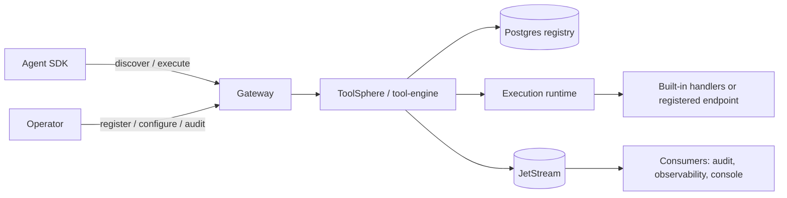

# ToolSphere

ToolSphere is AgentSphere's tenant-scoped tool registry and governed execution subsystem. Agents discover tool cards and invoke the runtime through the Gateway; they do not load, instantiate, or retain direct tool implementations.

## Subsystem

## Lifecycle

Tools move through `DRAFT`, `REGISTERED`, `VALIDATED`, `ACTIVE`, `DEPRECATED`, `DISABLED`, and `REMOVED`. Registration creates or updates the `(tenantId, name, version)` record. Validation checks the card and optionally a payload; activation makes a healthy, authorized card discoverable. Deprecation preserves historical execution and audit data while excluding the tool from ordinary discovery. Deletion removes the active registry card and publishes a lifecycle event.

## Tool SDK

`packages/tool-sdk` defines the handler interface, card metadata, JSON Schema validation, and structured runtime errors. A tool declares capabilities, authentication, permissions, configuration schema, rate limits, supported protocols, and input/output schemas. Secrets are supplied through per-tool configuration and are never returned by the configuration API.

## Registry tables

| Table | Purpose |
| --- | --- |
| `tool_registry` | Canonical Tool Card identity (tenant, name, category, lifecycle, row_version) |
| `tool_versions` | Immutable version history with `is_latest` |
| `tool_capabilities` | Discoverable capability index |
| `tool_tags` | Tag index for marketplace filters |
| `tool_configuration` | Per-tenant non-secret values + secret refs |
| `tool_permissions` | RBAC/ABAC allow/deny grants |
| `tool_metrics` | Windowed execution counters and latency aggregates |
| `tool_health` | Latest health probe per tool version |
| `tool_audit` | Tenant-scoped audit trail |
| `tool_dependencies` | Tool-to-tool dependency graph |
| `tool_executions` | Execution history with idempotency keys |
| `tools` (V4) | Legacy dual-write compatibility table |

Schema: `V4__tool_registry.sql` + `V5__toolsphere_platform.sql`.

## Execution model

The runtime supports `SYNC`, `ASYNC`, `STREAMING`, `BATCH`, `LONG_RUNNING`, and `SCHEDULED` execution modes. Synchronous calls return output directly; asynchronous work returns an accepted execution identifier for later inspection. Idempotency keys prevent duplicate work within the request scope. Global, tenant, and per-tool bulkheads bound concurrent execution. Circuit breakers open after configured failures and reset after their configured cooling period. Timeout, retry budget, cancellation token, correlation ID, and attempt count are persisted with execution state.

## Events

ToolSphere publishes CloudEvents to the JetStream `AGENTSPHERE` stream on `agentsphere.tool.*` subjects. Current events include registration, update, deletion, deprecation, configuration, execution success/failure, and health transitions. Event payloads carry tenant and correlation context; consumers must preserve tenant isolation and treat events as at-least-once delivered.

## Multi-tenancy

`tenantId` is the hard isolation boundary. Gateway JWT claims override supplied tenant headers, and ToolSphere rejects a body tenant that differs from the resolved request tenant. `projectId` is an optional narrower execution scope. Registry queries, discovery, configuration, permissions, health, metrics, executions, and audit records are tenant-filtered.

## Built-in catalog

38 production handlers are seeded for the `default` tenant (real adapters; missing credentials return `TOOL_NOT_CONFIGURED`):

| Group | Tools |
| --- | --- |
| Core Mesh | `mesh.agent.registry`, `mesh.discovery`, `mesh.heartbeat`, `mesh.health`, `mesh.configuration`, `mesh.secrets`, `mesh.policy`, `mesh.audit`, `mesh.metrics`, `mesh.tracing` |
| Data | `postgres.query`, `redis.command`, `mongodb.command`, `filesystem.read/write/list` |
| Messaging | `kafka.publish`, `rabbitmq.publish` |
| DevOps | `github.request`, `git.exec`, `docker.exec`, `kubernetes.request` |
| Browser | `browser.fetch`, `web.search` |
| AI | `openai.chat`, `anthropic.messages`, `gemini.generate`, `ollama.chat`, `openrouter.chat` |
| Observability / Security | `vault.kv`, `prometheus.query`, `grafana.proxy`, `loki.query`, `tempo.trace` |
| Productivity / Identity | `email.send`, `slack.post`, `teams.message`, `keycloak.admin` |

## Agent integration

1. An agent calls `GET /mesh/tools/v1/tools/discover` with capability, authorization, and latency constraints.
2. It selects a returned active ToolCard, then validates input with `POST /mesh/tools/v1/tools/validate` when needed.
3. It invokes `POST /mesh/tools/v1/tools/execute` (or the compatibility path `/mesh/tools/v1/execute`) with tenant, correlation, timeout, and idempotency context.
4. For asynchronous work, it tracks the returned `executionId` through the executions endpoint and cancels through the cancel endpoint when appropriate.

Agents must always discover and execute through ToolSphere. They must never instantiate built-in handlers, connect directly to a tool endpoint, or bypass registry authorization and audit controls.
